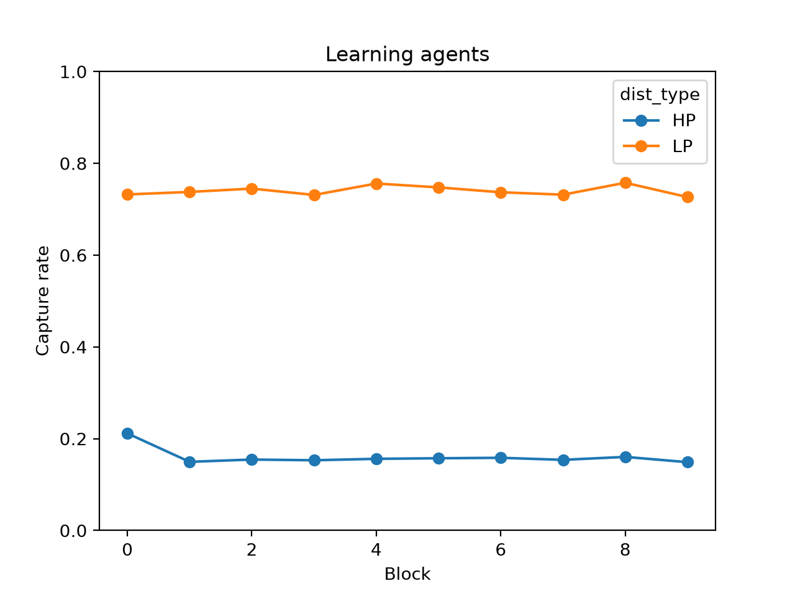
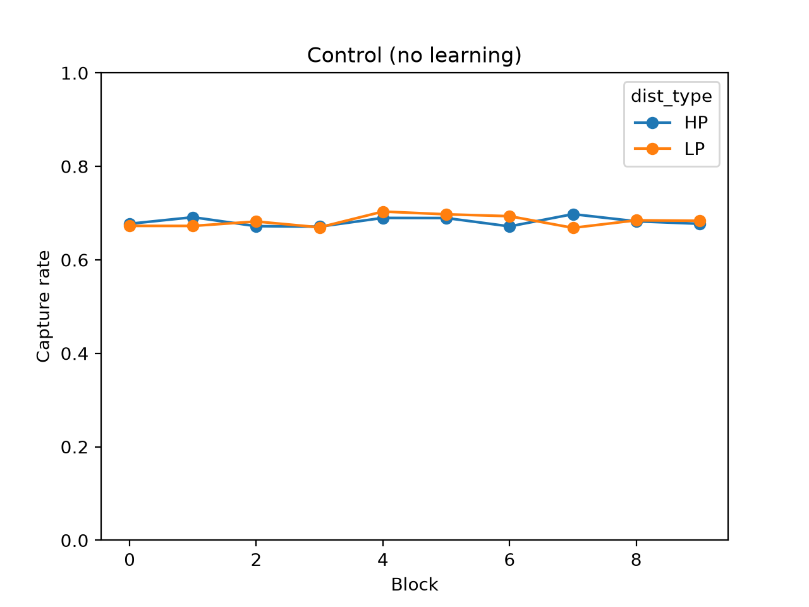
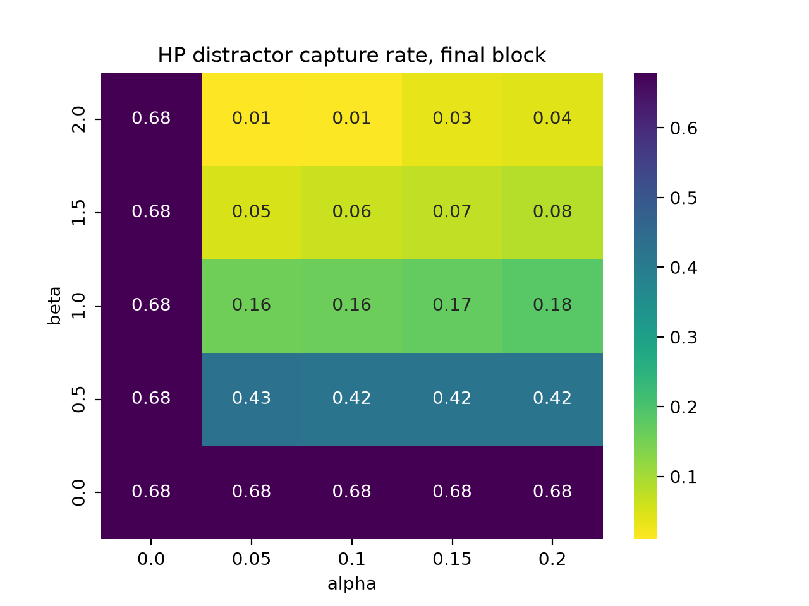

# Statistical Learning and Attentional Suppression: A Computational Model

## Question
Can a simulated agent learn to suppress a location where distractors appear
frequently (70% of trials)?

## Model
Priority map = salience - beta * learned distractor probability + noise.
Learning: delta rule (rate alpha). Control: alpha = 0 (no learning).

## Parameters
- 6 locations; the distractor is at the high-probability (HP) location on 70% of
  trials and at each other location on 6%; the target is placed randomly at
  another location
- 50 agents x 800 trials, in 10 blocks of 80 trials
- Salience: target 1.0, distractor 1.2; noise SD 0.3
- RT = 300 ms + 50 ms per location inspected
- Across agents: alpha ~ N(0.1, 0.03), beta ~ N(1.0, 0.2)
- Sweep: alpha in {0, 0.05, 0.1, 0.15, 0.2} x beta in {0, 0.5, 1, 1.5, 2},
  10 agents per cell, final block (last 80 trials)

## How to run
```bash
pip install -r requirements.txt
python scripts/run_simulation.py
python scripts/run_control.py
python scripts/analyze.py
python scripts/analyze_control.py
python scripts/run_sweep.py
python scripts/plot_sweep.py
```

## Key results





When the distractor appeared at the HP location, learning agents were captured
on about 15% of trials after the first block, versus about 73% when it appeared
at an LP location. HP capture dropped within
the first block (about 21% averaged over block 0) and then stayed stable. Control
agents (alpha = 0) showed no HP/LP difference (about 68% for both). LP capture is slightly higher than in the control, likely because LP distractors
are suppressed less than in the control and because targets at the suppressed HP
location are more often outcompeted by LP distractors.

In the parameter sweep, final-block HP capture was 0.68 (no suppression)
whenever alpha = 0 or beta = 0. Otherwise it fell as beta increased (about 0.42-0.43 at beta 0.5, 0.16-0.18 at
1.0, 0.05-0.08 at 1.5, and 0.01-0.04 at 2.0), with little dependence on alpha
in the final block. Each cell uses only 10 agents, so differences of 0.01
to 0.02 are within noise.
Because the sweep only measures the final block, it shows how strong suppression
becomes (beta) but not how quickly it is learned (alpha).